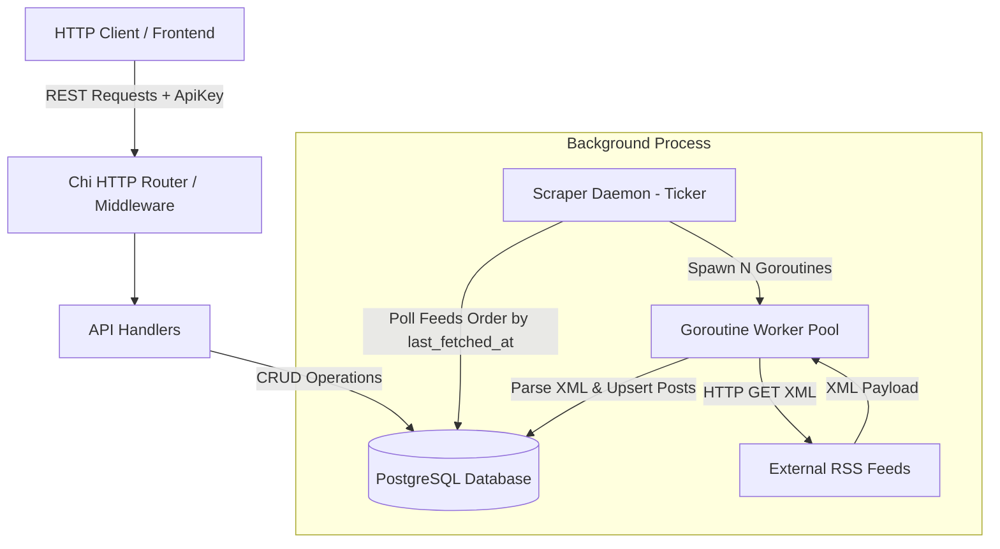
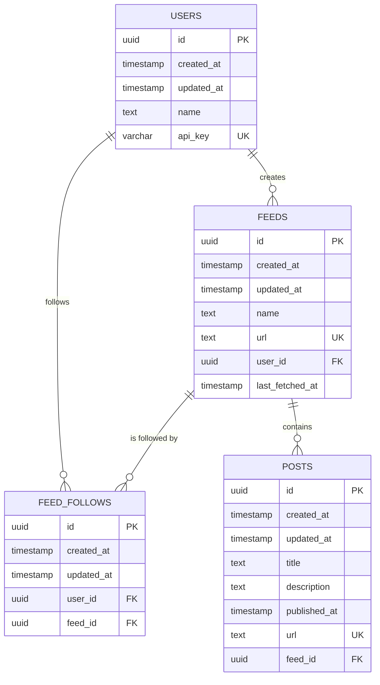

# RSS Feed Aggregator & Scraper API

A high-performance, concurrent RSS feed aggregator and RESTful backend service built with **Go (Golang)** and **PostgreSQL**. The application provides an automated platform for subscribing to RSS feeds, managing user accounts with API key authentication, and continuously ingesting posts from external sources into a relational database using concurrent background workers.

---

## Table of Contents

- [Overview](#overview)
- [Architecture & Design](#architecture--design)
  - [High-Level Architecture](#high-level-architecture)
  - [Concurrent Scraping Engine](#concurrent-scraping-engine)
- [Key Features](#key-features)
- [Tech Stack](#tech-stack)
- [Database Schema & Data Model](#database-schema--data-model)
  - [Entity Relationship Diagram](#entity-relationship-diagram)
  - [Tables Breakdown](#tables-breakdown)
- [API Reference](#api-reference)
  - [Authentication](#authentication)
  - [Health & Diagnostics](#health--diagnostics)
  - [Users](#users)
  - [Feeds](#feeds)
  - [Feed Follows](#feed-follows)
  - [Posts](#posts)
- [Directory Structure](#directory-structure)
- [Prerequisites & Tools](#prerequisites--tools)
- [Installation & Setup](#installation--setup)
  - [1. Clone Repository](#1-clone-repository)
  - [2. Environment Configuration](#2-environment-configuration)
  - [3. Database Migrations (Goose)](#3-database-migrations-goose)
  - [4. SQL Code Generation (sqlc)](#4-sql-code-generation-sqlc)
  - [5. Run the Application](#5-run-the-application)
- [End-to-End Testing Workflow](#end-to-end-testing-workflow)
- [License](#license)

---

## Overview

Modern web users often consume articles and news from dozens of disjointed blogs, news outlets, and personal sites. **RSS Aggregator** addresses this fragmentation by acting as a centralized aggregator service.

The system allows clients to:
1. **Register Users**: Instantly provision users with unique, cryptographically random SHA-256 API keys.
2. **Track Feeds**: Register any standard XML RSS 2.0 feed URL.
3. **Follow / Unfollow Feeds**: Subscribe users to specific feeds.
4. **Automated Content Harvesting**: An asynchronous background worker continuously monitors registered feeds, schedules fetches, parses XML payloads into Go models, and stores newly discovered posts in PostgreSQL while deduplicating existing entries.
5. **Fetch Customized Post Feed**: Authenticated users can retrieve the latest articles aggregated exclusively from the feeds they follow, sorted chronologically.

---

## Architecture & Design

### High-Level Architecture

The service runs a hybrid architecture comprising a **synchronous REST API** for user interactions and an **asynchronous concurrent scraping engine** executing in background goroutines.



### Concurrent Scraping Engine

The background scraper (`scraper.go`) operates independently from the HTTP server:
- **Periodic Triggering**: Utilizes `time.NewTicker` to fire fetching cycles at a configurable interval (default: every 1 minute).
- **Batch Processing**: Retrieves the oldest feeds based on `last_fetched_at ASC NULLS FIRST` with a configurable concurrency limit (default: 10 feeds per cycle).
- **Worker Synchronization**: Spawns a dedicated goroutine for each feed fetch, synchronized with a `sync.WaitGroup`.
- **Feed Marking**: Immediately updates `last_fetched_at` to avoid race conditions and redundant fetches across intervals.
- **Duplicate Prevention**: Ignores unique constraint collisions on post URLs, safely handling republished or already ingested articles without interrupting the worker.

---

## Key Features

- **Blazing Fast Go Server**: Backed by the lightweight and composable `chi` router with built-in CORS configuration.
- **Type-Safe Database Access**: Powered by `sqlc`, generating 100% type-safe Go query methods directly from raw SQL queries.
- **Robust Schema Migrations**: Employs Goose migration scripts for controlled, repeatable database schema changes.
- **Background Multi-threaded Scraping**: Non-blocking worker routines for continuous data synchronization.
- **Stateless API Key Authentication**: Custom HTTP middleware authenticating requests via the `Authorization: ApiKey <TOKEN>` header.
- **Zero ORM Overhead**: Clean native SQL queries compiled to Go code without dynamic query reflection penalties.

---

## Tech Stack

| Component | Technology | Description |
| :--- | :--- | :--- |
| **Language** | [Go (Golang)](https://go.dev/) (1.22+) | High performance, concurrency primitives |
| **Database** | [PostgreSQL](https://www.postgresql.org/) | Relational store with ACID guarantees |
| **HTTP Router** | [chi v5](https://github.com/go-chi/chi) | Idiomatic, lightweight HTTP routing |
| **CORS Middleware** | [cors](https://github.com/go-chi/cors) | Cross-Origin Resource Sharing handling |
| **DB Driver** | [lib/pq](https://github.com/lib/pq) | Pure Go Postgres driver |
| **SQL Compiler** | [sqlc](https://sqlc.dev/) | Generates type-safe Go code from SQL |
| **Migrations** | [goose](https://github.com/pressly/goose) | Database migration tool |
| **Config Loader** | [godotenv](https://github.com/joho/godotenv) | Reads environment variables from `.env` |
| **Identifiers** | [google/uuid](https://github.com/google/uuid) | RFC 4122 UUID generator |

---

## Database Schema & Data Model

### Entity Relationship Diagram



### Tables Breakdown

1. **`users`**:
   - `id` (`UUID`, Primary Key)
   - `name` (`TEXT`, Required)
   - `api_key` (`VARCHAR(64)`, Unique, Auto-generated via SHA-256 random byte string)
   - `created_at`, `updated_at` (`TIMESTAMP`)

2. **`feeds`**:
   - `id` (`UUID`, Primary Key)
   - `name` (`TEXT`, Required)
   - `url` (`TEXT`, Unique RSS URL)
   - `user_id` (`UUID`, Foreign Key references `users(id)` ON DELETE CASCADE)
   - `last_fetched_at` (`TIMESTAMP`, Nullable, records last scraper access)
   - `created_at`, `updated_at` (`TIMESTAMP`)

3. **`feed_follows`**:
   - `id` (`UUID`, Primary Key)
   - `user_id` (`UUID`, References `users(id)` ON DELETE CASCADE)
   - `feed_id` (`UUID`, References `feeds(id)` ON DELETE CASCADE)
   - `UNIQUE(user_id, feed_id)` to prevent duplicate subscriptions
   - `created_at`, `updated_at` (`TIMESTAMP`)

4. **`posts`**:
   - `id` (`UUID`, Primary Key)
   - `title` (`TEXT`, Required)
   - `description` (`TEXT`, Nullable)
   - `published_at` (`TIMESTAMP`, Parsed RFC1123Z timestamp)
   - `url` (`TEXT`, Unique post article URL)
   - `feed_id` (`UUID`, Foreign Key references `feeds(id)` ON DELETE CASCADE)
   - `created_at`, `updated_at` (`TIMESTAMP`)

---

## API Reference

Base URL: `http://localhost:8000/v1` (or your configured `PORT`)

### Authentication

Protected routes require the `Authorization` header formatted as:
```http
Authorization: ApiKey <YOUR_API_KEY>
```

---

### Health & Diagnostics

#### 1. Readiness Probe
- **Endpoint**: `GET /healthz`
- **Auth**: None
- **Response**: `200 OK`
```json
{}
```

#### 2. Error Handler Test
- **Endpoint**: `GET /err`
- **Auth**: None
- **Response**: `400 Bad Request`
```json
{
  "error": "Something went wrong"
}
```

---

### Users

#### 1. Create User
- **Endpoint**: `POST /users`
- **Auth**: None
- **Request Body**:
```json
{
  "name": "Jane Doe"
}
```
- **Response**: `200 OK`
```json
{
  "id": "e9bcf2e1-4c6f-4098-b805-4c0757ad7ff4",
  "created_at": "2026-10-12T02:00:00Z",
  "updated_at": "2026-10-12T02:00:00Z",
  "name": "Jane Doe",
  "api_key": "9a38f32389d428fafe98..."
}
```

#### 2. Get Current User
- **Endpoint**: `GET /users`
- **Auth**: Required (`ApiKey`)
- **Response**: `200 OK`
```json
{
  "id": "e9bcf2e1-4c6f-4098-b805-4c0757ad7ff4",
  "created_at": "2026-10-12T02:00:00Z",
  "updated_at": "2026-10-12T02:00:00Z",
  "name": "Jane Doe",
  "api_key": "9a38f32389d428fafe98..."
}
```

---

### Feeds

#### 1. Create Feed
- **Endpoint**: `POST /feeds`
- **Auth**: Required (`ApiKey`)
- **Request Body**:
```json
{
  "name": "Boot.dev Blog",
  "url": "https://blog.boot.dev/index.xml"
}
```
- **Response**: `200 OK`
```json
{
  "id": "7a356241-11d8-4f81-8e4d-7bc7eb1d1b33",
  "created_at": "2026-10-12T02:05:00Z",
  "updated_at": "2026-10-12T02:05:00Z",
  "name": "Boot.dev Blog",
  "url": "https://blog.boot.dev/index.xml",
  "user_id": "e9bcf2e1-4c6f-4098-b805-4c0757ad7ff4"
}
```

#### 2. Get All Feeds
- **Endpoint**: `GET /feeds`
- **Auth**: None
- **Response**: `200 OK`
```json
[
  {
    "id": "7a356241-11d8-4f81-8e4d-7bc7eb1d1b33",
    "created_at": "2026-10-12T02:05:00Z",
    "updated_at": "2026-10-12T02:05:00Z",
    "name": "Boot.dev Blog",
    "url": "https://blog.boot.dev/index.xml",
    "user_id": "e9bcf2e1-4c6f-4098-b805-4c0757ad7ff4"
  }
]
```

---

### Feed Follows

#### 1. Follow a Feed
- **Endpoint**: `POST /feed-follows`
- **Auth**: Required (`ApiKey`)
- **Request Body**:
```json
{
  "feed_id": "7a356241-11d8-4f81-8e4d-7bc7eb1d1b33"
}
```
- **Response**: `200 OK`
```json
{
  "id": "d043d839-58b8-45b0-a3ce-bdfd5fa7bb68",
  "created_at": "2026-10-12T02:10:00Z",
  "updated_at": "2026-10-12T02:10:00Z",
  "user_id": "e9bcf2e1-4c6f-4098-b805-4c0757ad7ff4",
  "feed_id": "7a356241-11d8-4f81-8e4d-7bc7eb1d1b33"
}
```

#### 2. Get Followed Feeds
- **Endpoint**: `GET /feed-follows`
- **Auth**: Required (`ApiKey`)
- **Response**: `201 Created`
```json
[
  {
    "id": "d043d839-58b8-45b0-a3ce-bdfd5fa7bb68",
    "created_at": "2026-10-12T02:10:00Z",
    "updated_at": "2026-10-12T02:10:00Z",
    "user_id": "e9bcf2e1-4c6f-4098-b805-4c0757ad7ff4",
    "feed_id": "7a356241-11d8-4f81-8e4d-7bc7eb1d1b33"
  }
]
```

#### 3. Unfollow a Feed
- **Endpoint**: `DELETE /feed-follows/{feedFollowID}`
- **Auth**: Required (`ApiKey`)
- **Response**: `200 OK`
```json
{}
```

---

### Posts

#### 1. Get Posts for Authenticated User
Retrieves up to 10 latest scraped posts from all feeds currently followed by the authenticated user.
- **Endpoint**: `GET /posts`
- **Auth**: Required (`ApiKey`)
- **Response**: `200 OK`
```json
[
  {
    "id": "c138c227-fbf4-4df0-94e8-fdb6a8ca30e1",
    "created_at": "2026-10-12T02:15:00Z",
    "updated_at": "2026-10-12T02:15:00Z",
    "title": "Why Go is great for backend engineering",
    "description": "An introduction to concurrency and simplicity in Go...",
    "published_at": "2026-10-11T18:30:00Z",
    "url": "https://blog.boot.dev/golang/why-go-is-great",
    "feed_id": "7a356241-11d8-4f81-8e4d-7bc7eb1d1b33"
  }
]
```

---

## Directory Structure

```plaintext
RSS-Aggregator/
├── .env                         # Local environment variable definitions
├── .gitignore                   # Ignored files (binaries, .env, IDE configs)
├── go.mod                       # Go module definition and dependencies
├── go.sum                       # Checksums for Go dependencies
├── main.go                      # Application bootstrap, routing & server entrypoint
├── models.go                    # API response models & DB-to-JSON mappers
├── json.go                      # Standard JSON response & error formatting helpers
├── middleware_auth.go           # Authentication middleware validating ApiKey headers
├── rss.go                       # XML models and HTTP client for RSS feed fetching
├── scraper.go                   # Concurrency worker loop fetching & storing feed posts
├── handler_readiness.go         # Health check endpoint (/v1/healthz)
├── handler_err.go               # Error simulation endpoint (/v1/err)
├── handler_user.go              # User creation & retrieval endpoints
├── handler_feed.go              # Feed creation & listing endpoints
├── handler_feed_follows.go      # Feed subscription (follow/unfollow) endpoints
├── sqlc.yaml                    # sqlc compiler configuration
├── internal/
│   └── database/
│       ├── auth/
│       │   └── auth.go          # Header parser for ApiKey extraction
│       ├── db.go                # sqlc-generated DB connection & interface
│       ├── models.go            # sqlc-generated database entity structs
│       ├── users.sql.go         # sqlc-generated queries for users
│       ├── feeds.sql.go         # sqlc-generated queries for feeds
│       ├── feed_follows.sql.go  # sqlc-generated queries for feed_follows
│       └── posts.sql.go         # sqlc-generated queries for posts
└── sql/
    ├── queries/                 # SQL query definitions used by sqlc
    │   ├── users.sql
    │   ├── feeds.sql
    │   ├── feed_follows.sql
    │   └── posts.sql
    └── schema/                  # Database migration files (Goose format)
        ├── 001_users.sql
        ├── 002_users_apikey.sql
        ├── 003_feeds.sql
        ├── 004_feed_follows.sql
        ├── 005_feeds_lastfetchedat.sql
        └── 007_posts.sql
```

---

## Prerequisites & Tools

Make sure you have the following installed on your machine:
- **Go** (version 1.22 or higher) - [Download](https://go.dev/dl/)
- **PostgreSQL** (version 14+) - [Download](https://www.postgresql.org/download/)
- **Goose** (database migration tool):
  ```bash
  go install github.com/pressly/goose/v3/cmd/goose@latest
  ```
- **sqlc** (type-safe SQL compiler):
  ```bash
  # Windows (via scoop or binary) or:
  go install github.com/sqlc-dev/sqlc/cmd/sqlc@latest
  ```

---

## Installation & Setup

### 1. Clone Repository

```bash
git clone https://github.com/nishankx/RSS-Aggregator.git
cd RSS-Aggregator
```

### 2. Environment Configuration

Create a `.env` file in the root directory:

```env
PORT=8000
DB_URL=postgres://<username>:<password>@localhost:5432/rssagg?sslmode=disable
```

Ensure the target PostgreSQL database (e.g. `rssagg`) is created:
```sql
CREATE DATABASE rssagg;
```

### 3. Database Migrations (Goose)

Run Goose migrations against your PostgreSQL database:

```bash
cd sql/schema
goose postgres "postgres://<username>:<password>@localhost:5432/rssagg?sslmode=disable" up
cd ../..
```

To roll back a migration if needed:
```bash
goose postgres "postgres://<username>:<password>@localhost:5432/rssagg?sslmode=disable" down
```

### 4. SQL Code Generation (sqlc)

Whenever you add or modify `.sql` files in `sql/queries/` or schemas in `sql/schema/`:

```bash
sqlc generate
```

This compiles queries into type-safe Go structs in `internal/database/`.

### 5. Run the Application

Run the server with Go:
```bash
go run .
```

Or build a binary executable:
```bash
go build -o rssagg
./rssagg
```

You should see logs indicating the server is running and the background scraper is active:
```plaintext
2026/10/12 02:00:00 Scraping on 10 goroutines every 1m0s duration
2026/10/12 02:00:00 Server starting on port 8000
```

---

## End-to-End Testing Workflow

Test the complete flow using `curl`:

### Step 1: Create a User
```bash
curl -X POST http://localhost:8000/v1/users \
  -H "Content-Type: application/json" \
  -d '{"name": "Alice"}'
```
*Note the returned `api_key` and user `id`.*

### Step 2: Create a Feed
```bash
curl -X POST http://localhost:8000/v1/feeds \
  -H "Content-Type: application/json" \
  -H "Authorization: ApiKey <ALICE_API_KEY>" \
  -d '{
    "name": "Boot.dev Blog",
    "url": "https://blog.boot.dev/index.xml"
  }'
```
*Note the returned `id` (this is the `feed_id`).*

### Step 3: Follow the Feed
```bash
curl -X POST http://localhost:8000/v1/feed-follows \
  -H "Content-Type: application/json" \
  -H "Authorization: ApiKey <ALICE_API_KEY>" \
  -d '{"feed_id": "<FEED_ID>"}'
```

### Step 4: Wait for the Scraper & Query Posts
Allow the background scraper to complete its interval (or check console logs for `collected, X posts found`), then query the aggregated articles:

```bash
curl -X GET http://localhost:8000/v1/posts \
  -H "Authorization: ApiKey <ALICE_API_KEY>"
```

---

## License

This project is open-source and available under the [MIT License](LICENSE).
